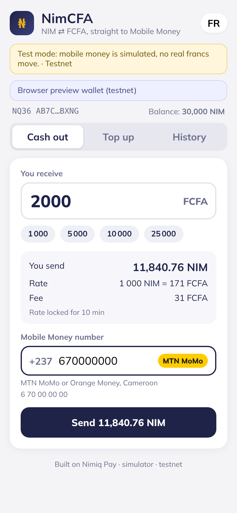

# NimCFA: NIM ⇄ FCFA on Mobile Money

A Nimiq Pay mini app for Cameroon (CEMAC). You can **cash out NIM to MTN MoMo or Orange Money** in FCFA, or **top up NIM by paying with mobile money**, in a few taps from inside Nimiq Pay. The app is bilingual in French and English.

> **Status: sandbox.** Mobile money runs on a simulator or a provider sandbox (Fapshi or CamPay), and Nimiq runs on testnet. No real francs move. The UI shows this on every screen.



## Try it

* **Mini app (GitHub Pages):** https://mbanyadev.github.io/nimcfa/ (open it in Nimiq Pay → Mini Apps → Custom URL, on testnet).
* **Demo video (2:31):** [docs/video/nimcfa-demo.mp4](docs/video/nimcfa-demo.mp4), recorded headless from the live Pages build on testnet (`docs/video/record.mjs` + `build.py`).
* In a desktop browser the app falls back to a testnet preview wallet held by the server, so you can click through cash-out, top-up and refund without installing anything.
* The app talks to the server set at build time (`VITE_API_URL`). To point the same build at another server, add `?api=https://your-server` to the URL once.

## How it works

**Cash out (off-ramp)**
1. Enter the FCFA amount you want to receive and your MoMo/OM number. The operator is detected from the prefix.
2. The server locks a quote for 10 minutes and creates an order with a memo (`NIMCFA <id>`).
3. Nimiq Pay asks you to approve one transaction to the escrow address, with the memo attached.
4. The server checks the transaction on-chain: network, recipient, memo, sender (must be your connected wallet), amount and execution result. It then pays out through the mobile money provider.
5. **If the payout is rejected, your NIM goes back to you automatically.** Deposits that arrive late, are too small, or come from the wrong wallet are refunded too. If the payout outcome is unknown, the order is held for manual review instead of being retried, so it is never paid twice.

**Top up (on-ramp)**
1. Enter the FCFA amount and your number. The server checks it has enough NIM before asking you to pay.
2. A USSD push prompt appears on your phone. Approve it, or dial `*126#` (MTN) or `#150*50#` (Orange).
3. Once the provider confirms, the NIM is sent to your Nimiq Pay address.

The **History** tab lists your past orders and their on-chain links.

## Architecture

```
app/     Vite + React + @nimiq/mini-app-sdk (runs inside Nimiq Pay)
server/  Node + Hono order engine
  ├─ Nimiq: JSON-RPC (nimiqwatch) for chain reads/broadcast, @nimiq/core for signing
  ├─ pricing: CoinGecko NIM/EUR × 655.957 (fixed XAF/EUR peg), cached
  ├─ providers/: simulator | fapshi | campay (pluggable payout + collect)
  └─ worker: 4 s loop: deposit detection, payouts, collections, refunds, expiry
```

Fees default to 1.5% (cash-out) and 2% (top-up), with limits of 100 to 500,000 FCFA per order (configurable).

## Run locally

```bash
npm run install:all
cd server && cp .env.example .env
npm run init:treasury        # testnet: generates an escrow key into .env and taps the faucet once
npm run dev                  # http://localhost:8787
# other terminal
cd app && npm run dev        # http://localhost:5173 (also on your LAN IP)
```

* **In Nimiq Pay:** go to Mini Apps → Custom URL (switch to testnet in the hidden developer menu: long-press Settings for about 10 s) → `http://<your-LAN-IP>:5173`.
* **In a desktop browser:** set `ENABLE_DEV_WALLET=true` and `DEV_WALLET_PRIVATE_KEY` in `server/.env` (testnet only). The app then uses a server-side test wallet so you can click through the whole flow.
* `npm test` runs the unit tests and the typecheck. `npm run e2e -- 670000000` runs a full testnet cash-out and top-up against the running server. With the simulator, numbers ending in 1 or 3 fail, so you can watch a refund happen.

### Deploy

* **App:** `VITE_API_URL=https://<server> ./scripts/deploy-pages.sh` builds `app/` and publishes it to the `gh-pages` branch (GitHub Pages).
* **Server:** `render.yaml` is a Render Blueprint for the free plan (testnet + simulator). Use https://render.com/deploy?repo=https://github.com/mbanyadev/nimcfa and paste `TREASURY_PRIVATE_KEY` and `DEV_WALLET_PRIVATE_KEY` (testnet keys) when asked. The free plan sleeps after 15 minutes idle, so the first request can take about a minute.

### Configuration
See `server/.env.example`. Key settings: `NIM_NETWORK` (testnet|mainnet), `TREASURY_PRIVATE_KEY`, `PAYOUT_PROVIDER` (simulator|fapshi|campay) and the matching provider credentials, `ALLOWED_ORIGINS`. **No secrets are committed.**

## Security notes
* The escrow key lives only in the server environment. The app never sees a private key, and users approve every transaction in Nimiq Pay.
* Phone numbers are masked in API responses.
* A deposit is accepted only from the wallet that created the order and only with the matching memo, so nobody can claim someone else's transaction.
* A payout is attempted at most once per order.

## Roadmap
* USDT (Polygon) cash-out alongside NIM
* An agent network: verified local MoMo agents hold NIM float and settle peer-to-peer through escrow
* Gabon, Congo, Chad, CAR and Equatorial Guinea (the other CEMAC countries), plus Wave and Moov for UEMOA

## License
MIT © 2026 Mbanya Dev
